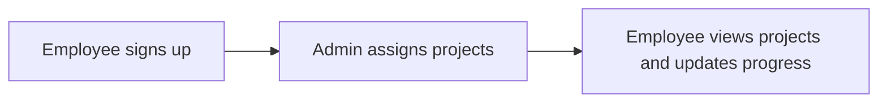
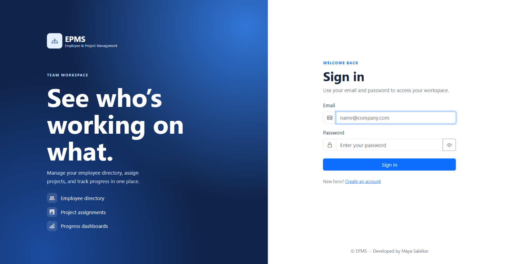
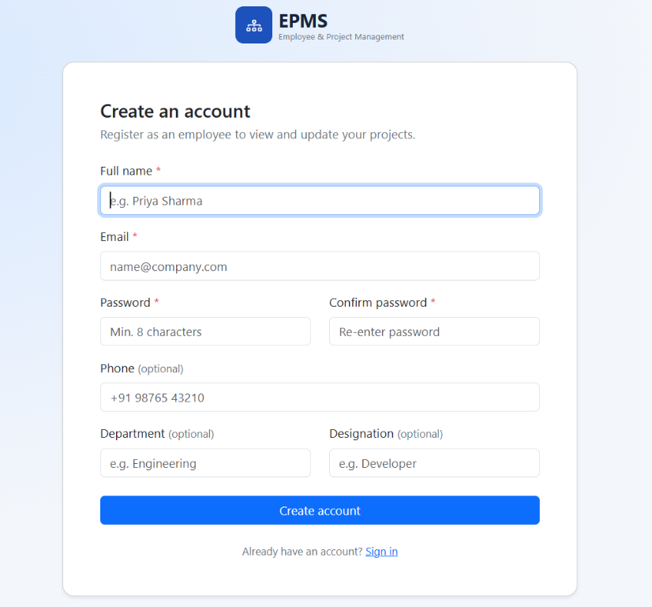
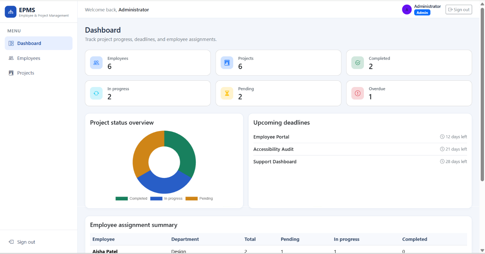
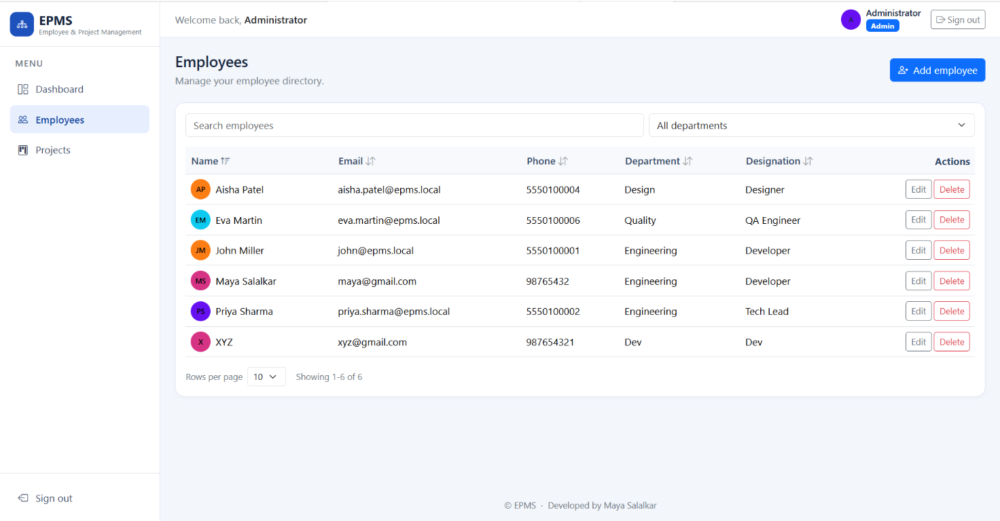
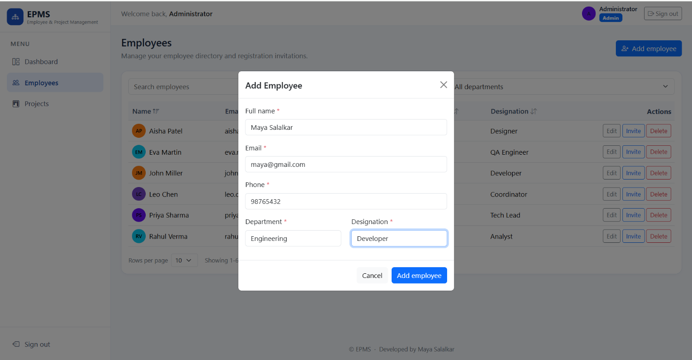
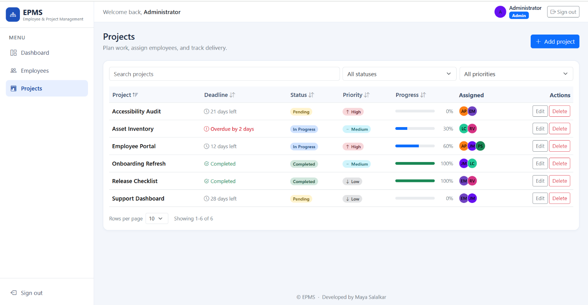
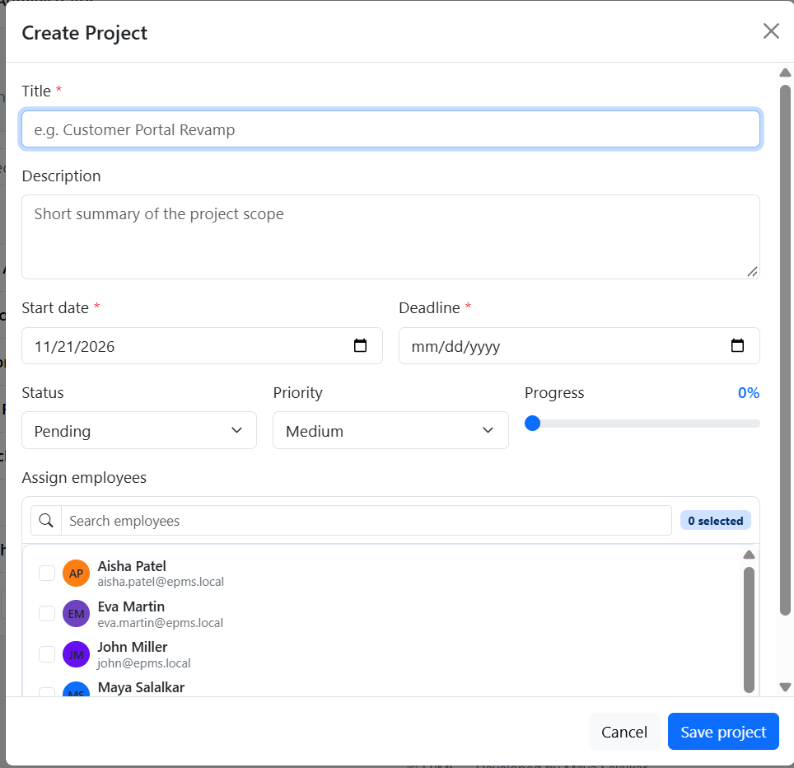
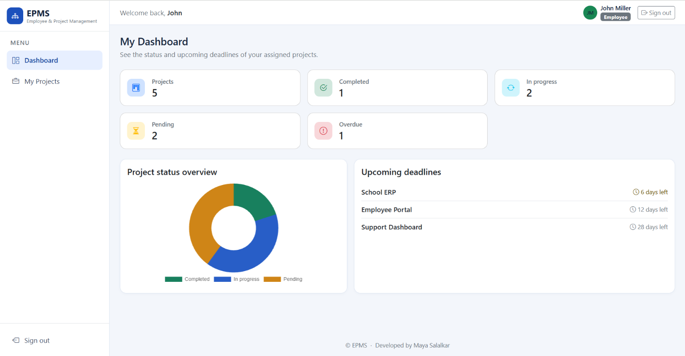
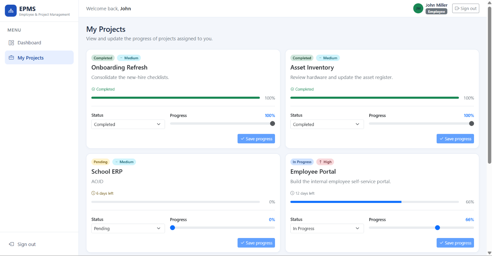

# Employee & Project Management System (EPMS)

Mentroid full-stack assessment by **Maya Salalkar**. Built with ASP.NET Core 10, EF Core, JWT, React, and Bootstrap.

## 1. Set up and run

Clone the repository or extract the submission. Open its root in PowerShell with **.NET 10 SDK** and **Node.js 24 LTS or newer** installed.

**Terminal 1 — API:** SQL Server is the assessment database. Set `ConnectionStrings:SqlServer` in `backend\Epms.Api\appsettings.json` to your server and an empty database. To run locally without SQL Server, skip the `DatabaseProvider` line to use SQLite.

```powershell
Set-Location .\backend\Epms.Api
$env:DatabaseProvider = 'SqlServer'
$env:Demo__AdminPassword = 'Admin@123'
$env:Demo__EmployeePassword = 'Employee@123'
dotnet run --launch-profile http
```

**Terminal 2 — UI** (from the project root):

```powershell
Set-Location .\frontend\epms-web
npm ci
npm run dev
```

| Open | URL |
|---|---|
| Web app | <http://localhost:5173> |
| Swagger API explorer | <http://localhost:5080/swagger> |

If you change the API port, set `VITE_API_URL` in `frontend\epms-web\.env`.

## 2. Sign in with demo data

No database file is included. On first startup against a fresh database, the API creates the schema and seeds six employees, six projects, and both logins using the passwords above. Restarting does not duplicate data or reset passwords. SQLite stores changes in `backend\Epms.Api\epms.db`; SQL Server stores them in the configured database.

| Role | Email | Demo password | What you can do |
|---|---|---|---|
| Admin | `admin@epms.local` | `Admin@123` | Manage employees, projects, and assignments; view the full dashboard |
| Employee | `john@epms.local` | `Employee@123` | View your dashboard and assigned projects; update their status and progress |

### Registration and project flow

Sign-up creates an Employee login, never an Admin login. An Admin assigns projects, and employees can view and update progress only on their assigned projects.  
In the local demo, signing up with the email of an existing profile without a login keeps its existing assignments. Production does not link profiles by email alone.



## 3. Demo screenshots

<details>
<summary>Sign in and registration</summary>

**Sign in** — Entry point for Admin and Employee accounts.



**Create an account** — Self-registration for Employees.



</details>

<details>
<summary>Admin portal</summary>

**Dashboard** — Project status and employee assignments at a glance.



**Employees** — Search, filter, and manage the directory.



**Add employee** — Enter contact and job details.



**Projects** — Filter projects and check progress.



**Create project** — Add project details and select assignees.



</details>

<details>
<summary>Employee portal</summary>

**My Dashboard** — Status and deadlines for assigned projects.



**My Projects** — Drag the 0–100% slider, then click **Save progress**.



</details>

## API and tests

API routes are listed in [Swagger](http://localhost:5080/swagger) and the [OpenAPI export](./docs/swagger.json). In Swagger, call `POST /api/auth/login` and paste the JWT into **Authorize** without the `Bearer` prefix.

Run `dotnet test .\backend\Epms.sln` from the project root. See the [ER diagram](./docs/er-diagram.md), [test cases](./docs/test-cases.md), and [test results](./docs/test-results.txt). Automated tests use SQLite; SQL Server, [Docker Compose](./docker-compose.yml), and [CI](./.github/workflows/ci.yml) were not run locally. No live deployment is included.
