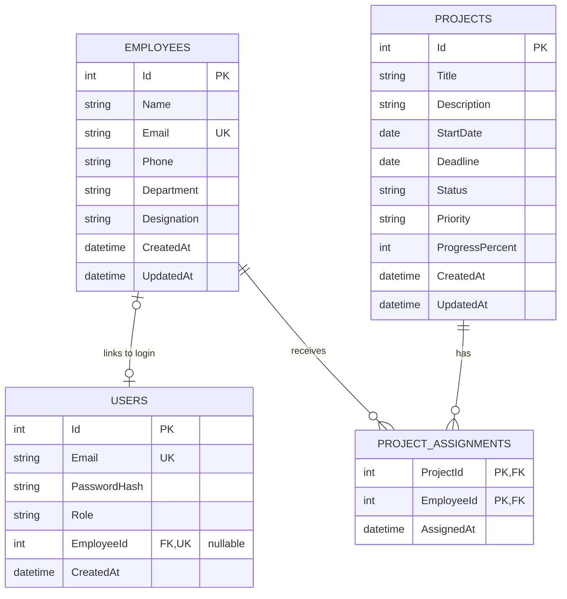

# EPMS entity relationship diagram

Project writes require at least one assignee. Removing a project cascades to its assignments; removing an employee cascades to their assignments and linked login. The database enforces unique normalized emails, unique linked employee IDs, deadline on or after start date, and progress between 0 and 100. Roles, statuses, and priorities are stored as strings.
